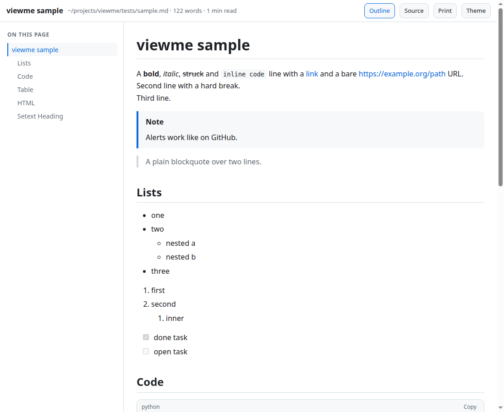
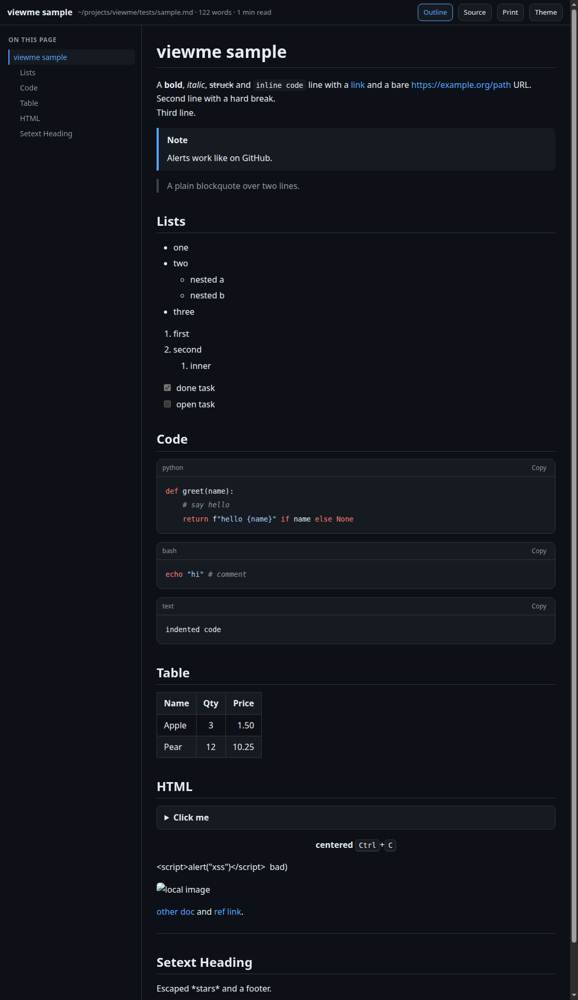

# viewme

Open any Markdown file in a clean, pretty popup window from your terminal.

```console
$ viewme README.md
```



<details>
<summary>Dark mode</summary>



</details>

## Why

Reading raw Markdown in a terminal is hard on the eyes, and opening a full editor or browser tab for a quick look is heavy. `viewme` renders the file and shows it in its own small window (no tabs, no address bar) and gets out of your way. The command returns immediately, so your prompt stays free.

## Features

- Outline sidebar with scroll tracking, headings with anchor links
- Tables with alignment, task lists, nested lists, blockquotes, GitHub-style alerts (`> [!NOTE]`)
- Fenced code blocks with light syntax highlighting and a one-click copy button
- Relative images and links to other `.md` files work, including from sub-folders of a git repo
- Live reload: the window updates whenever the file changes on disk
- Light and dark themes (remembered), raw-source toggle, print, reading time
- Read from a pipe: `git log --stat | viewme -`
- **No dependencies** beyond Python 3 and a browser

## Install

```bash
git clone <this repo> && cd viewme
./install.sh            # installs to ~/.local (or /usr/local when run as root)
./install.sh --uninstall
```

This installs the `viewme` command, its man page (`man viewme`) and tab completion for bash, zsh and fish. Make sure `<prefix>/bin` is on your `PATH`.

- **bash:** completion loads automatically in new shells (needs the `bash-completion` package).
- **zsh:** add `fpath=(~/.local/share/zsh/site-functions $fpath)` to `~/.zshrc` before `compinit`.
- **fish:** picked up from `~/.config/fish/completions`.

The bash completion and man page are tested; the zsh and fish completion files have not been run.

### Requirements

- Python 3.8 or newer
- For the popup window: Google Chrome, Chromium, Brave, Edge or Vivaldi. Without one, viewme opens your default browser instead. Set `VIEWME_BROWSER` to pick a specific one.

## Usage

```bash
viewme FILE.md                 # open a popup and return to the prompt
viewme --theme dark notes.md   # choose a theme (remembered for next time)
viewme --size 1280x800 doc.md  # window size
viewme --fg doc.md             # wait until the window is closed
viewme --serve doc.md          # no window: print a local URL to open yourself
cat notes.md | viewme -        # read from stdin
```

Keys in the window: <kbd>t</kbd> theme, <kbd>o</kbd> outline, <kbd>s</kbd> source.

## Safety

- The server listens on `127.0.0.1` only, on a random port, and exits when the window closes.
- Each run uses a random token (handed to the window as a cookie), checks the `Host` header, and serves only files inside the project root (the nearest parent folder with `.git`, otherwise the file's folder).
- Raw HTML in Markdown is limited to a small safe set of tags. Scripts, event handlers and `javascript:` URLs are removed, and a strict Content Security Policy is applied.

## Tests

```bash
python3 tests/test_render.py
```

`tests/sample.md` exercises most features, and is handy to open with `viewme tests/sample.md`.

## Limits

The built-in renderer covers everyday Markdown (CommonMark plus tables, task lists, strikethrough and alerts) but is not a full spec implementation. Footnotes, math and diagrams are not rendered.

## License

MIT
